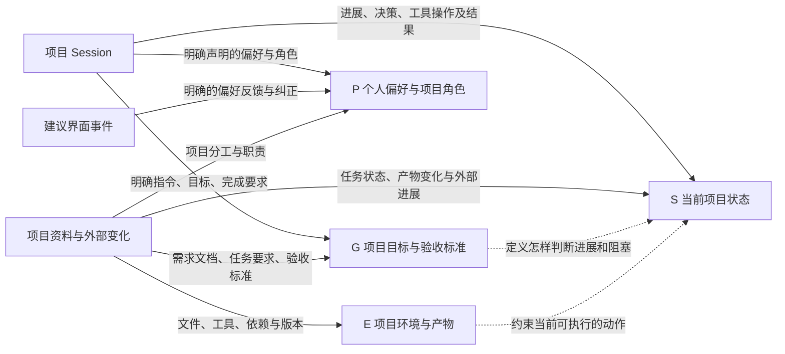
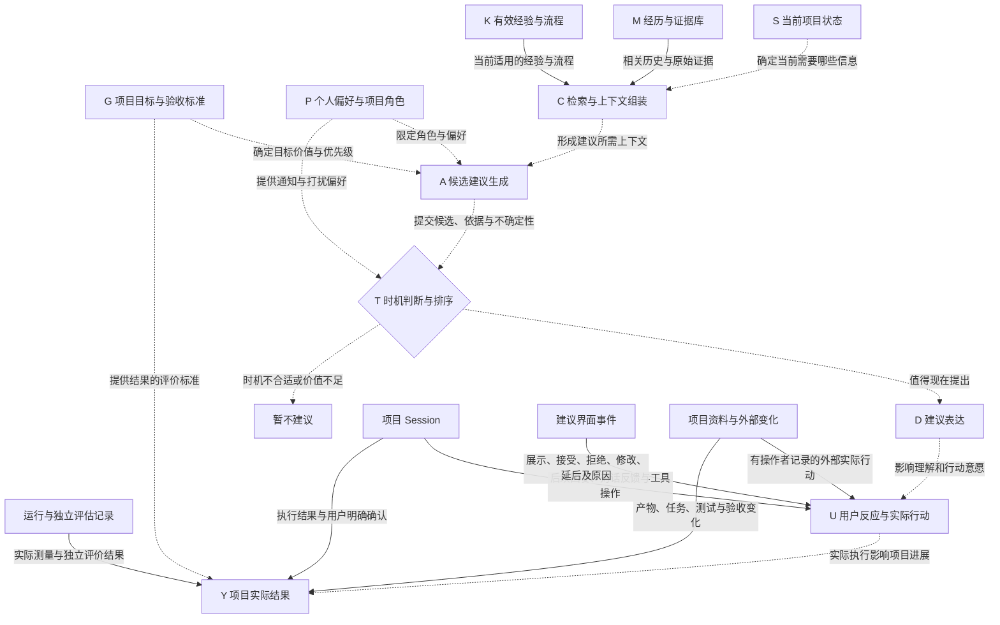
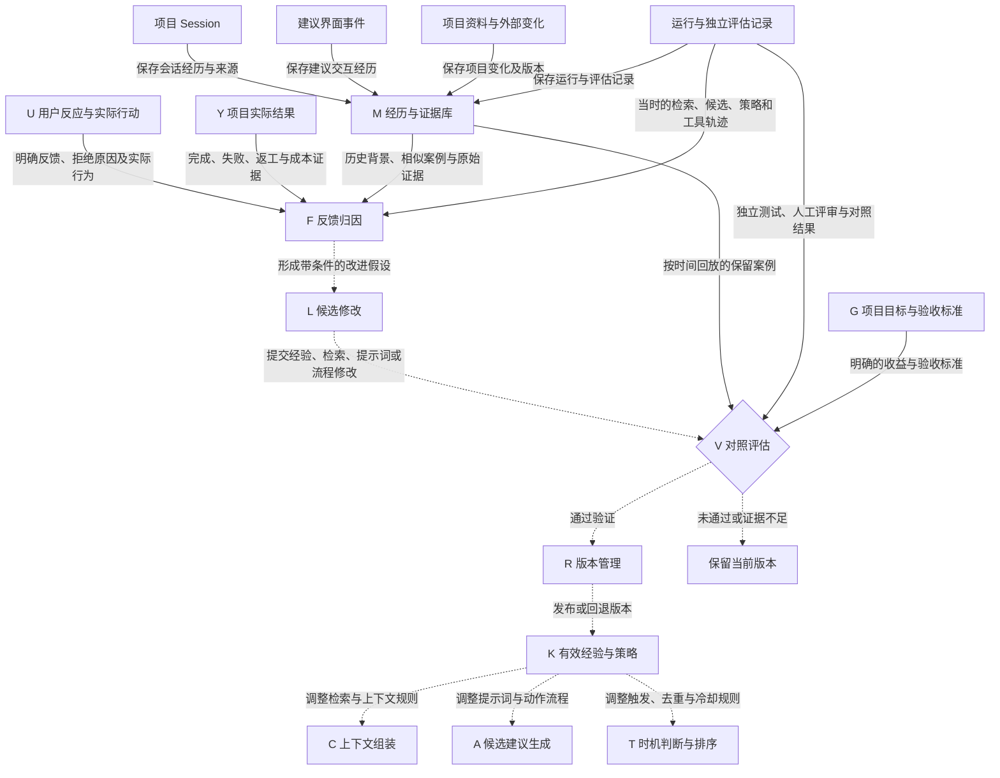
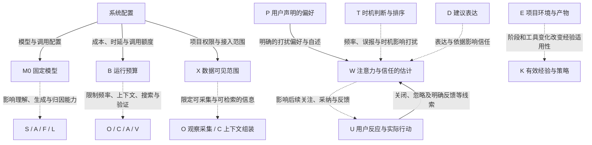

# RSI 框架

创建日期：2026-10-19。

本文描述一个以项目为单位、观察用户行为与交互结果、主动给出下一步建议，并根据证据改善建议方式的 Agent 系统。图中的模块是设计元素，不表示当前仓库已经实现了全部能力。

## 1. 范围与组织原则

- 固定底层模型参数和结构；可改进的范围包括记忆、上下文组织、检索规则、提示词、工具使用流程、建议触发与排序，以及 Agent 外围代码。
- 项目层维护目标、状态、约束、产物和经历；用户 × 项目层归属角色及交互反馈；个人层保存明确或经过验证的稳定偏好；通用层保存经过跨项目验证的经验。
- 原始来源分别连接它实际供给的元素，连接上标明提供的信息。经历库是一个独立元素，不替代其他元素各自的信息来源。
- 区分原始记录、可观察事件、候选学习信号和经过验证的策略。“后来求助”“重复失败”“可能遗漏建议”等是从记录提取的信号，不是额外的采集来源。
- 运行闭环负责当前建议；学习闭环异步改善未来的建议方式。新事实及时更新项目理解，可复用策略经过验证后再发布。

## 2. 图例与原始来源

四张图中的同名节点代表同一个元素。

- **实线**：提供证据或明确的配置输入；箭头文字说明提供什么。
- **虚线**：模块间的推导、策略更新或影响；箭头文字说明影响机制。
- 图中的影响关系用于表达设计机制，不表示已经测得因果效应或影响强度。

| 来源 | 包含的记录 | 使用时需要保留的区别 |
| --- | --- | --- |
| 项目 Session | 用户指令、对话、修改要求、工具调用与结果、后续求助及反馈 | 用户明确陈述与 Agent 推断分开；允许跨多个 Session 关联同一任务 |
| 建议界面事件 | 展示、进入可见区域、接受、拒绝、关闭、修改、延后、反馈表单 | 可见不等于已经阅读；没有操作不等于明确拒绝；反馈表单与 Session 中的反馈可以相互关联 |
| 项目资料与外部变化 | 正式资料、需求、验收标准、任务板、文件及版本、构建与测试、协作者操作 | 区分当前正式要求、历史版本和临时草稿；外部操作需要操作者与时间证据 |
| 运行与独立评估记录 | 检索内容、候选建议、决策理由、策略版本、工具错误、时延、成本、独立测试、人工评审及对照结果 | 系统运行轨迹与独立评价分开；Agent 自评是判断或假设，不自动成为真实效果证据 |
| 系统配置（配置输入） | 固定模型及调用配置、运行预算、数据接入与权限范围 | 属于运行边界，不是从用户采纳行为中推断出的经验 |

“用户是否接受建议”和“拒绝原因”属于事件内容：如果记录在对话里，来源是 Session；如果记录在建议卡片或反馈表单里，来源是建议界面。

## 3. 图中元素说明

| 编号 | 元素 | 职责与含义 | 直接输入及主要输出 |
| --- | --- | --- | --- |
| G | 项目目标与验收标准 | 定义项目要完成什么，以及什么算有效进展、成功或失败 | 输入为 Session 中的明确要求和项目正式资料；影响 S 的状态判断、A 的目标价值判断及 V 的评估标准 |
| P | 个人偏好与项目角色 | 表达用户的稳定偏好，以及在当前项目中的分工和职责 | 来自明确声明、明确偏好反馈与项目分工资料；影响 A、T 和 W；项目内反馈先归属用户 × 项目范围 |
| E | 项目环境与产物 | 表达文件、工具、依赖、版本和当前可用条件 | 来自项目资料与外部变化；约束 S，并影响 K 中经验的适用性 |
| S | 当前项目状态 | 表达进展、决策、阻塞、待办和不确定性，是系统对项目的理解 | 来自 Session 与项目实际变化，并参考 G、E；为 C 确定本次需要哪些信息 |
| O | 观察采集 | 接入各渠道事件，保留身份、时间、来源和版本，关联并去重 | 输入为各原始渠道；为相应元素提供可追溯记录；受 X 与 B 约束，不要求所有元素先经过 M 才能获得信息 |
| M | 经历与证据库 | 保存发生过什么，以及可回溯的原始记录和引用 | 来源为四类记录渠道；支持 C 检索、F 归因和 V 的历史回放 |
| K | 有效经验与策略 | 保存当前已发布的经验、流程、提示词、检索及触发规则 | 由 R 发布或回退；按项目、用户 × 项目、个人、通用分层；影响 C、A、T |
| C | 检索与上下文组装 | 根据当前问题选取相关、仍适用的事实、经历和流程 | 输入为 S、M、K；输出供 A 使用的上下文；受 X、B 和固定模型能力约束 |
| A | 候选建议生成 | 产生候选动作及依据，说明目标价值、条件和不确定性 | 输入为 C、G、P 及 K 的有效策略；向 T 提交候选，不直接把候选等同于应展示的建议 |
| T | 时机判断与排序 | 判断是否现在提出建议，处理优先级、重复性、打扰成本和冷却规则 | 输入为 A、P、K 及当前情境；输出展示决策或暂不建议；其表现影响 W |
| D | 建议表达 | 把被选中的建议表达为可理解、可行动的内容 | 由 T 的展示决策触发；影响 U 的理解和行动意愿，以及 W 的信任；展示情况由建议界面记录 |
| U | 用户反应与实际行动 | 分开记录直接反应与后续真实操作 | 证据来自 Session、建议界面及有操作者记录的外部行为；影响 Y，并为 F 提供归因证据 |
| Y | 项目实际结果 | 表达推进、完成、失败、返工、耗时和成本等结果 | 证据来自执行返回、用户确认、产物与任务变化、独立测量；依据 G 解释结果；不能仅由是否点击接受得出 |
| F | 反馈归因 | 还原当时条件，判断哪里有效、哪里出错、哪里仍未知 | 输入为 U、Y、M 和当时运行轨迹；区分内容、时机、状态、检索、执行与环境问题，向 L 提出带适用条件的改进假设 |
| L | 候选修改 | 将归因结果转化为待验证的记忆、检索、提示词、流程或触发修改 | 输入为 F；向 V 提交候选版本；候选不直接覆盖有效版本 |
| V | 对照评估 | 检验修改是否改善效果，并检查打扰、遗漏、成本与回归 | 输入为 L、保留历史案例、独立测试与评价，以及 G 的明确标准；通过后交给 R，未通过或证据不足时保留当前版本 |
| R | 版本管理 | 发布、记录和回退有效版本 | 输入为 V 的结果及后续效果证据；向 K 发布可追踪版本，保留旧版本供比较和回退 |
| W | 注意力与信任的估计 | 表达用户当前的关注、打扰容忍与信任状况 | 依据 P 的明确声明和 U 的行为线索估计，保留不确定性；受 T、D 影响，也影响后续 U |
| M0 | 固定模型 | 提供理解、推理、生成和归因的基础能力 | 来自系统模型配置；本框架不更新其权重和结构；共同误判可能出现在 S、A、F、L 等多个环节 |
| B | 运行预算 | 限定观察、检索、候选搜索与验证可使用的资源 | 来自成本、时延和调用额度配置；约束 O、C、A、V |
| X | 数据可见范围 | 限定哪些渠道、项目资料和记录可被采集、检索 | 来自系统权限与接入配置；约束 O、C |

“暂不建议”是 T 的一种正常输出；未通过评估后“保留当前版本”是 V 的一种结果，二者不另设为独立能力模块。

## 4. 目标、偏好、环境和状态的信息来源

原始来源独立连接各元素，每条连接标明提供的信息；元素之间继续保留推导和约束关系。

## 5. 建议生成、用户反应与实际结果

建议生成保留独立的上下文、候选、时机和表达环节。用户反应与实际结果分别连接各自的证据来源。

展示、可见、接受、拒绝、后续行动和结果是不同事件，按同一建议标识关联。D 的展示产生建议界面记录；后续对话和工具操作进入 Session；外部操作和产物变化由相应渠道记录。新记录持续为下一轮 S、C、F、V 提供输入。

## 6. 自改进、独立评估和版本生效

经历库、明确反馈、实际结果、当时运行轨迹和独立评价分别提供证据。候选修改经过验证后，再更新有效经验与策略。

历史回放按时间组织，输入仅包含当时可获得的信息；候选修改的评估案例与用于生成修改的案例区分。独立评价、真实执行结果和人工评审用于检验改进，Agent 自己对建议的信心不能单独证明有效。

## 7. 跨层输入与影响

模型、预算和可见范围来自系统配置。注意力与信任依据明确声明和行为线索估计；环境变化会改变已有经验的适用性。

## 8. 事件关联、反馈归因与经验范围

### 8.1 同一事实的关联与去重

每条记录保留用户、项目、任务、Session、建议、事件时间、来源和相关产物版本。涉及策略判断时，同时保留策略版本、候选与被使用的记忆条目。

同一修改同时出现在 Session 和文件变更记录时，可以相互补证，但不计为两次独立成功。展示、用户反应和结果属于不同事件，应关联而不是合并为同一个状态字段。

### 8.2 反馈含义保持独立

| 观察 | 可以得到的信息 | 尚不能直接得到的结论 |
| --- | --- | --- |
| 建议没有进入可见区域 | 用户没有可观测的曝光机会 | 用户拒绝了建议 |
| 建议进入可见区域但没有操作 | 用户有机会看到，没有留下明确操作 | 用户已阅读，或建议无用 |
| 用户明确拒绝并给出原因 | 得到本次拒绝及用户陈述的理由 | 理由适用于所有项目，或已完整解释实际原因 |
| 用户接受但没有后续执行记录 | 得到采纳意向，执行和效果仍未知 | 项目已被推进 |
| 用户后来做了类似动作 | 动作方向可能相关 | 动作一定由该建议促成 |
| 采纳后失败或返工 | 有新的结果需要归因 | 建议内容必然错误；执行和环境因素仍需检查 |
| 未建议时用户后来求助或重复失败 | 得到可能遗漏辅助机会的线索 | 更早的某个时刻一定适合打断用户 |
| 用户说“等评审通过再做” | 更新依赖条件与触发时机 | 用户普遍不喜欢这类建议 |

### 8.3 经验归属与生效

- **项目层**：目标、约束、状态、产物、决策、依赖和项目专属流程。
- **用户 × 项目层**：当前角色、关注点、建议反馈及项目内的行为条件。
- **个人层**：用户明确声明或跨场景验证的稳定偏好。
- **通用层**：经跨项目验证、保留适用条件与反例的流程和策略。

原始证据、推断和有效策略分别保存。证据不足时保留未知；事实纠正及时更新项目理解；可复用做法经过验证和版本发布后影响后续建议。

## 9. 研究参考

以下研究提供机制参考；本文的具体元素划分、粒度与连线属于面向本场景的系统设计。

- [ProAgentBench：主动辅助的时机与内容评估](https://arxiv.org/abs/2602.04482)。
- [ACE：通过增量上下文与执行反馈改善 Agent](https://arxiv.org/abs/2510.04618)。
- [Agent Workflow Memory：从经历中提炼可复用流程](https://arxiv.org/abs/2409.07429)。
- [GEPA：依据执行轨迹优化提示词](https://arxiv.org/abs/2507.19457)。
- [PAST-Bench：保留经验能否改善后续行为的评估](https://arxiv.org/abs/2608.04003)。
