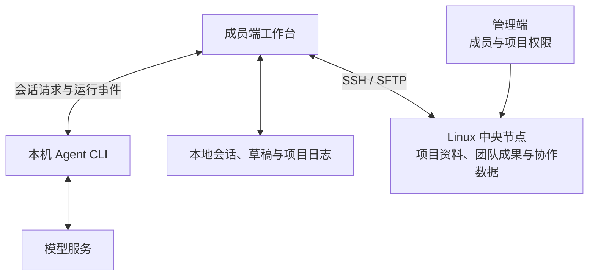
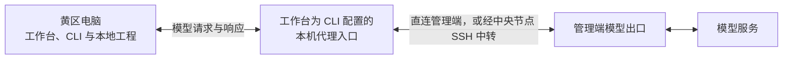

# 工具痛点与使用场景

## 一、需求分析

### 1. 核心目标：让开发者聚焦业务问题

工具的最终目标是开发一个team agent，针对现在团队开发的工作流提效。
初始边界为：个人和团队开发的已有工作流中低效环节，如：重复操作、信息搬运等。工作流本身的优化不在初始优化范围内，如：代码仓管理方式、代码质量检查流程等。

## 二、用户场景

本节先描述用户实际遇到的过程；采用工作台后的变化统一放在第五节对比。

### 2.1 一般工作场景

#### S1：自己正在探索，队友刚刚发现这条路线有问题

可能是 AI 在探索，也可能因为工作惯性，队友并不会立即通知自己。相关结论留在对方的会话中，自己继续沿同一路线尝试，形成重复探索。

#### S2：人补充的项目背景可能不完整

人总有遗漏。AI 根据当前聊天提出看起来合理的方案，并继续实现；用户也不一定知道它遗漏了哪个团队约束。这会导致agent的工作方向直接偏了，且后续纠正不如一次做对。

#### S3：同一个人开了多个 Session，不同在进行多个方向探索。

一个会话已经尝试过某种方案，或者形成某个结论，另一个会话无法快速感知，需要人传递；在建立新的session时，需要补充很多项目上下文。

#### S4：项目目标或验收口径变化，已有会话仍沿用旧背景

人更新文档或群公告后，还要记得逐个通知正在工作的成员；消息接受具备滞后性，会产生很多无效的工作推进成果。

#### S5：想使用项目中的资料，但是资料散落各处

项目需要各种资料：代码仓、调研的论文、周边模块接口人等等，这些信息散落在各处，在使用agent的时候要按需补充，但是入口不统一，导致操作繁琐。

#### S6：新成员加入工作，此时发现交接信息缺失

交接人需要找到相关信息，通过 Agent 以外的渠道交给新成员，新成员再补充进上下文。如果一次补充的信息不全，这个过程就会反复发生。

#### S7：两个项目成员在沟通、传递资料

通过 Agent 之外的聊天软件，把 Agent 生成的结论或文件传给对方，说明上下文；对方接收后，再复制粘贴到自己的 Agent 上下文中继续处理，交互繁琐。

### 2.2 绿区／黄区内网场景

以下场景以实际环境的网络和工具使用限制为前提。

#### N1：工程在黄区，黄区不能使用 Codex 桌面版

用户在绿区向 AI 提问，再把代码片段、建议和命令带到黄区执行；执行后，再把报错带回绿区继续问。一次调试可能往返多轮。

#### N2：因为权限限制，黄区很多工具用不了

需要处理的内容通过 WeLink 从黄区搬到绿区，处理完后再搬回黄区；WeLink 还需要重复登录，资料搬运打断了连续工作。

#### N3：成员分布在绿区和黄区，代码仓在黄区，无法基于同一个 Git 工作流协作

绿区开发的代码打包后，通过 WeLink 交给黄区成员；黄区成员再合并并提交代码仓。打包、交接、合并和分发需要额外协调。

## 三、痛点识别

通用工作场景与绿区／黄区内网场景分别归纳。每条痛点场景描述用户实际遇到的低效过程，根因说明这一过程为什么持续发生。

### 3.1 通用工作场景的痛点

| 痛点场景 | 对应场景 | 根因 |
| --- | --- | --- |
| **P1：Agent 开展工作、创建新会话或新人接手时，已有项目背景需要人重新补充，容易缺漏。** | S2（背景补充不完整）、S3（新建 Session 需补充上下文）、S6（新人接手时交接信息缺失） | 项目背景的汇集和交付依赖提问者或交接者当次提供材料，已有背景没有随着工作承接完整进入接收方的 Agent 上下文。 |
| **P2：成员或多个会话并行探索时，当前工作难以及时感知和利用其他地方已经形成的尝试记录与结论。** | S1（队友发现路线问题）、S3（多个 Session 探索不同方向） | 探索信息分别留在各自的会话中，需要人主动发现、通知和转述，缺少跨成员、跨会话的信息发现与复用通道。 |
| **P3：项目目标或验收口径变化后，正在进行的工作仍按旧背景推进，产生无效成果。** | S4（项目变化后仍沿用旧背景） | 项目文档、公告的更新与成员、Agent 所用背景的更新分离，依赖逐人通知和人工补入，变化传到实际工作上下文存在滞后。 |
| **P4：准备资料或成员交接时，需要从外部资料入口或聊天工具把信息手工补到 Agent；入口切换、传递和补漏操作繁琐。** | S5（资料入口分散）、S6（交接资料需要反复补充）、S7（结论或文件跨工具转交） | 资料来源与 Agent 的工作入口分散，成员间的信息交接也在 Agent 以外进行，查找、整理、转交和补入上下文需要人手工串联。 |

S3 同时涉及“新会话背景补充”和“并行探索信息感知”；S6 同时涉及“背景缺漏”和“交接操作”。表中按各自的实际环节对应。

### 3.2 绿区／黄区内网场景的痛点

| 痛点场景 | 对应场景 | 根因 |
| --- | --- | --- |
| **NP1：工程在黄区，Agent 提问在绿区，调试时需要往返搬运问题、代码、命令和执行结果。** | N1（黄区不能使用现有 Codex 桌面入口） | 工程所在环境无法使用现有 Agent 入口，提问端与执行端分离，缺少在工程环境中连续提问、执行和接收结果的通路。 |
| **NP2：黄区无法使用某些处理工具，输入资料和处理结果需要在两区之间反复搬运，还要重复登录传输工具。** | N2（工具受限后经 WeLink 往返传递资料） | 所需处理能力分布在不同环境，跨环境资料传递依赖独立的聊天或传输工具，与当前处理任务分离。 |
| **NP3：成员沿用现有黄区代码仓流程协作时，跨区代码包的打包、交接、接收合并和分发需要多方人工协调。** | N3（绿区产出代码包，黄区成员合并并提交） | 成员无法直接共用同一 Git 工作入口，代码通过文件包交付；其中重复执行的步骤与交接状态依赖人工安排和跟踪。 |

内网场景沿用已有环境限制和代码仓流程，优化其中的请求中转、资料搬运、重复操作与交接跟踪。

## 四、架构设计

### 4.1 通用工作场景的架构设计

本节只对应 S1～S7 和 P1～P4，围绕背景承接、信息发现、资料更新和成员协作展开。

#### 4.1.1 总体结构：成员端执行，中央节点共享项目资料

当前通用架构采用 **Electron 用户端与管理端 + 本地 Agent CLI + Linux 中央节点**。

| 组成 | 通用场景中的职责 |
| --- | --- |
| 成员端工作台 | 组织项目与会话，调用本机 Codex、Cursor 或 Claude Code CLI；维护输入草稿、参考资料、项目日志、成果及求助状态。 |
| Linux 中央节点 | 通过 SSH/SFTP 提供项目资料、团队成果、附件和协作数据，维护项目成员的访问权限。 |
| 管理端 | 管理中央节点的成员账号、项目组和访问权限，为团队共享资料提供管理入口。 |

用户界面经 preload IPC 调用主进程，由 `Workbench` 协调业务，再通过运行适配层与 CLI 交换输入、状态、输出和授权事件。工程文件操作和命令执行由成员电脑上的 CLI 完成。

代码对应：`src/renderer/main.tsx`、`src/main/preload.ts`、`src/main/index.ts`、`src/core/workbench.ts`、`src/core/agents.ts`、`src/core/claude-runtime.ts`。

#### 4.1.2 背景承接：把已有项目信息提供给当前会话

**对应痛点：P1。**

项目说明集中记录背景、目标、验收标准、现有资料入口、约束与协作约定。新会话默认引用项目说明；用户还可以选择相关个人或团队成果，补足当前任务所需的信息。

用户关联成果后，工作台保存所选版本的正文快照，并记录来源、版本和哈希。同一原生会话按送达状态记录已经提供过的资料，后续只补充新增或变化内容；发送失败不推进“已提供”状态。

这条链路承接的是“已有背景 → 当前 Agent 上下文”，减少创建会话和交接工作时重复组织背景的操作。

代码对应：`src/shared/project-brief.ts`、`src/core/session-context.ts`、`src/core/session-results.ts`，以及 `src/core/workbench.ts` 中的 `availableSessionContext`。

#### 4.1.3 信息发现：让并行探索中的记录与结论可被复用

**对应痛点：P2。**

并行探索的信息由两条不同范围的路径承接：

- **个人多会话：**同账号、同项目的工作会话维护独立摘要和最近 5 条简短日志。其他会话先获得近期工作线索，再按需读取摘要副本。
- **团队成员之间：**探索过程经整理、审阅后保存为个人成果或提交团队；相关成果、项目动态和工作记录进入推荐分析，用户判断是否采纳并关联到自己的会话。

成果整理开始时冻结本次对话和相关资料，记录时间、消息范围、哈希和来源文件。整理结果先形成草稿，经用户审阅后再保存或共享。用户明确关联推荐后，相关参考材料进入后续会话上下文。

这样既能支持不同方向之间的信息互补，也能让已经发现的路线问题成为其他成员可取得的参考依据。

代码对应：`src/core/project-journal.ts`、`src/core/preparation-snapshot.ts`、`src/core/preparation-prompt.ts`、`src/core/preparation.ts`、`src/core/rsi-workbench.ts`、`src/core/rsi.ts`，以及 `src/core/workbench.ts` 中的 `applyRecommendationReference`。

#### 4.1.4 变化传递：让后续工作采用更新后的项目背景

**对应痛点：P3。**

项目资料通过 `ProjectSync` 保存和同步版本。会话发送前检查需要采用的项目资料，在当前轮结束后的后续发送中提供新版背景，避免运行中途改写本轮依据。

会话上下文按来源和哈希识别已提供的资料，只补充新增版本；成果变更还通过动态处理机制向相关用户呈现。资料更新、变化发现和上下文采用各有状态，便于核对当前工作使用的依据。

代码对应：`src/core/project-sync.ts`、`src/core/session-context.ts`、`src/core/activity-assistant.ts`，以及 `src/core/workbench.ts` 中的 `adoptLatestProjectBrief` 和 `refreshProjectContext`。

#### 4.1.5 资料与协作入口：减少查找、转交和补充上下文的操作

**对应痛点：P4。**

统一入口分别承接“找资料”和“向人取得信息”：

| 工作环节 | 架构中的承接方式 |
| --- | --- |
| 查找项目资源与相关成员 | 项目说明集中记录资源入口和协作约定；成员名片提供成员方向与协作信息，帮助定位需要进一步询问的人。 |
| 把成果与文件用于当前工作 | 从项目成果入口选择个人或团队成果，关联对应版本。正文和附件索引随会话提供，附件由模型按需请求，工作台校验后返回本地文件路径。 |
| 向成员交接或补问信息 | 从当前工作发起求助，选择接收成员；对方可手动回答，也可关联已有工作会话生成答复。答案和附件沿问题通道返回，按用户配置可继续自动问答。 |

中央节点承载团队共享资料与协作记录，成员端按已认证节点、账号和项目组织数据与权限。个人成果及部分整理记录由 `AccountSync` 同步，完整会话运行状态和个人项目日志仍由本地机制管理。

代码对应：`src/renderer/directions.tsx`、`src/core/session-results.ts`、`src/core/questions.ts`、`server/content.py`、`src/core/account-sync.ts`、`src/shared/account-scope.ts`、`server/group_ops.py` 和 `server/acl_support.py`。

### 4.2 绿区／黄区内网场景的架构设计

本节只对应 N1～N3 和 NP1～NP3。设计沿用现有环境限制、代码仓和合并流程，分别承接模型请求、跨环境资料传递和重复任务。

#### 4.2.1 模型请求通路：在工程所在电脑连续使用 Agent

**对应痛点：NP1；对应场景：N1。**

黄区电脑运行工作台与可用的 Agent CLI，由 CLI 在本地工程目录读取文件、执行命令和取得结果，模型请求通过管理端出口转发。

管理端出口使用加密连接、证书指纹和接入凭据验证，再通过管理端的直连或上游代理访问模型服务。成员使用自己的模型账号。需要经中央节点中转时，管理端主动建立 SSH 反向隧道。

生效条件是工程所在电脑可以运行相应 CLI，且实际网络路径能够到达所选出口。提问、执行和查看结果因此可以在工程所在电脑的工作界面内连续进行。

代码对应：`src/core/egress.ts`、`src/core/ssh-egress.ts`、`src/admin/egress-host.ts`、`src/admin/egress-worker.ts` 和 `src/admin/reverse-egress.ts`。

#### 4.2.2 资料传递通路：承接到另一环境使用工具时的往返文件

**对应痛点：NP2；对应场景：N2。**

处理工具仍在其可用的环境中运行。工作台通过可达的共享节点或已有传输链路，承接输入资料的提交、另一环境的获取以及处理结果的回传；上传、下载、校验和失败状态由传输记录呈现。

这项设计解决的是跨环境使用工具时的资料搬运成本。两侧需要具备实际可达且有权限的资料通道；两个互不连通的资料库分别存在，并不会自动形成传输链路。

代码对应：`src/core/shared-files.ts`、`src/core/transfers.ts`、`src/core/session-results.ts` 和 `server/content.py`。

#### 4.2.3 重复步骤任务化：沿现有代码交付流程减少人工协调

**对应痛点：NP3；对应场景：N3。**

保持“绿区产出代码包 → 黄区成员合并并提交”的现有工作流，将其中可重复执行的打包、资料提交、拉取和分发步骤配置为定时任务，保留运行说明、使用的项目资料和执行结果。

定时任务复用工作会话和 CLI 的执行能力。具体动作由任务说明、CLI 可用工具或脚本落实；两侧的运行时间、交付位置与执行权限需要提前配置。合并策略、冲突处理和最终提交继续按项目既有约定执行。

代码对应：`src/core/scheduled-tasks.ts`、`src/shared/scheduled-task.ts`、`src/core/agents.ts` 和 `src/core/workbench.ts` 中的定时运行准备、执行与完成流程。

## 五、效果对比

### 5.1 一般工作场景

| 场景 | 原有方式 | 使用工作台以后 | 对注意力的直接改善 |
| --- | --- | --- | --- |
| S1：队友发现当前路线有问题 | 结论留在对方会话，自己可能继续重复探索。 | 队友使用 AI 异步整理探索过程并发布结论；工作台进行相关性分析，用户可把相关成果或推荐关联到当前会话。 | 减少追问队友、重复搜索和重复试错。 |
| S2：项目背景补充不完整 | 人逐条复述背景，容易遗漏团队约束。 | 项目资料默认进入 Session，相关成果可持续作为参考；后续变化通过资料版本和动态机制补充。 | 减少反复补背景和纠偏。 |
| S3：自己的多个 Session 重复尝试 | 人记住各窗口的进展，再手工转述。 | 同账号、同项目的会话维护简短日志与独立摘要，其他会话先取得线索，再按需核对。 | 减少由人维护“各窗口记忆”的负担。 |
| S4：目标或验收口径变化 | 更新文档后，还需逐人、逐窗口通知 AI。 | 项目公共资料集中更新；跟随项目资料的会话在后续合适时机采用新版背景，成果变更进入动态流程。 | 减少逐人提醒和逐窗口补充资料。 |
| S5：资料散落各处 | 找到文件后先下载，再上传或粘贴路径。 | 从项目成果入口关联相关成果，模型根据当前任务按需获取附件；所用正文保留版本与来源。 | 减少文件搬运、路径整理和版本确认。 |
| S6：新成员交接信息不全 | 交接人另找渠道发材料，新成员再补进上下文，缺什么再问。 | 从当前 Session 发起具体求助，可询问相关成员；对方关联已有上下文的会话回答，答案沿原通道返回，必要时继续问答。 | 减少反复交接和背景重述。 |
| S7：成员沟通和传递资料 | 结论或文件经过聊天软件转交，再复制到另一侧 Agent。 | 已共享结论可直接从团队成果库关联到 Session；明确知道资料持有人时，也可通过提问取得答复与资料。 | 减少在 Agent 与聊天软件之间切换。 |

### 5.2 绿区／黄区内网场景

| 场景 | 原有方式 | 使用工作台以后 | 生效条件 |
| --- | --- | --- | --- |
| N1：工程与可用模型入口不在同一环境 | 绿区提问、黄区执行，再把报错带回绿区，多轮往返。 | 在工程所在电脑运行工作台和 CLI，通过管理端出口访问模型服务，在当前工作目录执行并继续对话。 | 工程所在电脑能运行相应 CLI，且可通过直连或中央节点中转访问管理端出口。 |
| N2：跨环境资料传递繁琐 | 依赖 WeLink 等渠道反复登录、上传和下载。 | 在具备连通与访问权限的资料通道上，统一管理团队成果、附件及传输记录，减少重复搬运步骤。 | 两侧具有实际可达的共享或传输路径；分别管理两个互不连通的资料库本身不会形成传输通道。 |
| N3：跨环境代码交接依赖人工 | 打包、交给对方、合并、提交和分发需要逐项协调。 | 将每日打包、资料提交、拉取和后续处理配置为定时任务，保留运行结果；需要人工判断的合并冲突和最终提交由项目流程承接。 | 提前配置任务、脚本、仓库与权限，运行时相关电脑和服务可用。 |

### 5.3 汇报中如何说明收益

以上对比说明的是当前代码所支撑的工作方式变化。实际试点可进一步记录：一次协作需要切换多少个工具、同一背景重复补充多少次、从队友发布成果到被采用耗时多久，以及一次跨环境调试需要人工往返多少轮。用这些数据衡量注意力消耗和协作成本的变化，再补充量化收益。
