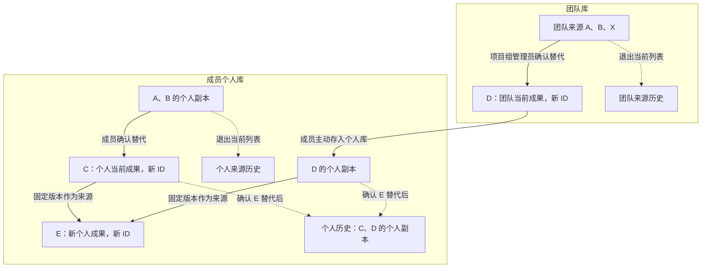

# 成果整理与来源追溯交接

> 状态：产品规则已讨论，以下代码改动尚未完成。  
> 核对代码基准：`9f2e310b329c5b4b7e17caa84a08232a40bd9f7f`。  
> 范围：项目组成员的个人成果、项目组共享成果，以及由它们继续整理出的新成果。

## 一、统一规则

1. **身份与版本**：每条已保存成果有稳定的唯一 ID。编辑同一条成果保留 ID、增加版本号；整理得到新成果则分配新 ID。标题可修改，不能充当身份标识。个人副本有自己的 ID，同时保留其团队来源的 ID 和版本。
2. **来源与替代分开**：`derivedFrom` 记录新成果直接依据的 `范围 + 项目 ID + 成果 ID + 版本`；`replaces` 记录确认由新成果替代的旧成果。引用一条成果不会自动替代它。只存直接来源，向上追溯时按需遍历；禁止循环，展示底层来源时按 ID 和版本去重。
3. **隐藏的范围**：确认个人整理后，所选个人来源退出本人的当前列表，进入可查看的个人历史。确认团队整理后，所选团队来源退出团队当前列表，进入组内可查看的团队历史。历史须保留当时的正文、附件引用、作者、ID 和版本；它不参与默认推荐或新的多选整理。显式删除另行处理，至少保留能说明引用不可用的标记。
4. **权限独立**：`submitted/curated` 表示谁能维护团队成果；`当前/被替代` 表示它在哪个列表展示。项目组管理员编辑并保存单条团队成果后，ID 不变，版本增加，原上传成员失去直接修改和删除权限。团队范围的替代由项目组管理员确认；成员的个人整理只能隐藏本人的个人来源。
5. **公开边界**：未分享的个人成果只有本人可见。个人成果上传团队时生成独立的团队 ID，不自动替代任何团队成果。公开来源信息仅包含该成员明确选择披露的私有依据；本人个人库保留完整的私有追溯链。
6. **版本冻结**：E 使用 `C@v1`、`D@v2` 后，即使 C 或 D 更新，E 仍指向当时版本。界面可提示来源已有新版本；更新 E 需要用户再次整理或编辑，已有会话引用也保持原快照。

来源集合的包含关系仅用于提示，不驱动权限、归档或自动合并：

| 关系 | 示例 | 处理 |
| --- | --- | --- |
| C 来源是 D 的子集 | C 用 A、B；D 用 A、B、X | C 保留在个人库，D 保留在团队库 |
| D 来源是 C 的子集 | C 用 A、B、X；D 用 A、B | 各自保留；C 的独有依据不会自动公开 |
| C、D 来源有交集 | C 用 A、B；D 用 B、X | 各自保留；详情可显示共同和独有来源 |

比较时须核对具体版本。同一来源 ID 的不同版本应标出版本差异。

## 二、完整示例与展示范围

- C 未提交团队时，项目组管理员只看到 D。成员将 D 存入个人库后，C 和 D 的个人副本分别显示在现有个人成果列表中；沿用个人库与团队库两个页面，不新增“相关成果组”。
- E 确认替代 C 与 D 的个人副本后，个人当前列表显示 E；C、D 的个人副本进入个人历史。团队库的 D 保持当前状态。成员若只是引用 C、D 写一条补充，则 C、D 继续显示在个人当前列表。
- 成员以后分享 C 或 E，团队获得一条新提交。是否用它替代团队 D，由项目组管理员明确确认；来源有交集、子集关系或者管理员已整理过，都不触发自动替代。
- 个人与团队成果详情应能查看 ID、版本、直接来源、替代记录和历史正文，并可复制完整 ID。按 ID 打开历史来源时，不受当前列表筛选影响。

## 三、现有实现与差距

- `src/core/workbench.ts` 的 `commitConclusionMerge` 已为个人整理结果生成新 ID，并在确认后归档所选个人来源；须补足稳定的直接来源引用、历史追溯、跨库版本关系。
- `src/core/workbench.ts` 的 `commitContentMerge` 目前把第一条团队来源作为合并结果，沿用它的 ID。`server/content.py` 与 `src/core/content-files.ts` 会从当前索引移除其他来源并删除旧文件；现有 `provenance` 主要保留标题、作者和版本，不能完整回看原文。新团队整理必须生成新 ID，并保存所有来源的历史快照。
- `src/core/workbench.ts` 的 `syncContentUpdates` 目前把从团队当前索引消失的条目按删除识别；增加团队历史后，应单独呈现“已被成果 D 替代”，保留真正删除的通知语义。
- `src/renderer/shared-content.tsx` 的默认可见列表还受“与个人库有差异”筛选影响；按 ID 定位当前或历史成果须绕过该筛选。`src/renderer/conclusions.tsx` 和团队成果详情尚无成果 ID 展示、复制和完整替代历史。
- `src/shared/content.ts` 的上传元数据尚无明确的公开来源协议；`src/core/account-sync.ts` 要验证新增个人来源字段能随账号同步，且不会把本机私有内容直接写入团队索引。

## 四、建议交给其他 agent 的修改包

### 1. 协议与数据模型

主要文件：`src/shared/content.ts`、`src/shared/types.ts`。

- 定义带范围与版本的直接来源引用、显式替代引用、成果历史状态。区分团队治理状态与列表可见状态。
- 固定新旧数据的读取方式；保留旧成果 ID。旧合并记录如已丢失原文，只标记“历史正文不可用”，不补造内容。
- 定义个人来源发布到团队时的披露字段；私有来源 ID、标题、正文不应未经成员选择进入共享索引。

### 2. 服务端与本地存储

主要文件：`server/content.py`、`src/core/content-files.ts`、`src/core/sftp.ts`、`src/core/local-files.ts`。

- 团队合并分配新 ID；在同一受锁操作中核对全部来源版本、写入新成果并归档来源。失败时不能留下部分替代。
- 为团队历史保存可读取的版本快照及附件引用，提供按 ID/版本读取的接口。旧客户端读取当前索引时不能把历史当成当前成果。
- 服务端逐项校验项目与组权限；跨组、失去组权限或使用过期版本的请求应拒绝。保留单条管理员编辑同 ID、版本递增、维护权转移的行为。

### 3. 工作流程与同步

主要文件：`src/core/workbench.ts`、`src/main/index.ts`、`src/core/account-sync.ts`、`src/core/store.ts`。

- 个人整理与团队整理都写入直接来源和替代关系；后续 C/D→E 继续引用固定版本，按需追溯多层来源。
- 个人成果上传团队创建新团队 ID，不改变私有 C 或团队 D 的状态。团队来源替代须有项目组管理员确认操作。
- 把团队“被替代”事件与“已删除”事件分开，同一操作在刷新、重启、账号同步后不重复通知。

### 4. 用户界面

主要文件：`src/renderer/conclusions.tsx`、`src/renderer/shared-content.tsx`、`src/renderer/draft-editor.tsx`。

- 保持现有个人库、团队库两个页面；当前列表隐藏被替代来源，历史入口可以查原文及来源链。
- 成果详情增加 ID/复制、版本、直接来源、替代记录和来源新版提示。涉及私有来源时遵守可见范围。
- 整理确认按钮明确说明本次会把哪些**个人**或**团队**来源移入历史。单纯引用不触发归档。

### 5. 测试与兼容

主要文件：`tests/test_content.py`、`tests/collaboration-lifecycle.test.ts`、`tests/conclusions.test.ts`、`tests/conclusion-publications.test.ts`。

验收至少覆盖：

1. 单条团队成果经管理员编辑后 ID 不变、版本增加、原作者失去修改和删除权限。
2. 成员整理个人 A、B 得到新 ID 的 C，仅个人 A、B 进入历史，团队来源不变。
3. 项目组管理员整理团队 A、B、X 得到新 ID 的 D，团队来源可从历史按 ID/版本回看；成员收到“被替代”而非“删除”动态。
4. D 存入成员个人库后与私有 C 分别显示；C 与 D 的来源为子集、反向子集、交集三种情况时，均不自动归档彼此。
5. 成员整理 C 与 D 的个人副本得到 E；个人 C、D 副本入历史，团队 D 不变；E 记录两条直接来源的固定版本。
6. D 后续更新时 E 保持原来源版本并提示新版本；旧会话引用不被改写。
7. 私有 C 未分享时管理员不可见；公开 E 不泄露未经成员同意披露的私有来源。
8. 并发修订冲突、跨组越权、失败回滚、旧记录兼容、账号同步及旧客户端当前列表行为。

## 五、手册收尾

代码与界面验收完成后再更新使用手册。沿用现有可复用生成脚本，只刷新 HTML；不改 Markdown、Word、PDF。手册应展示个人与团队两端的当前/历史变化、C/D/E 示例及明确的按钮入口，并记录更新所依据的代码 commit ID。此前已改动但尚未提交的 `docs/handbook/` 文件须保留。
